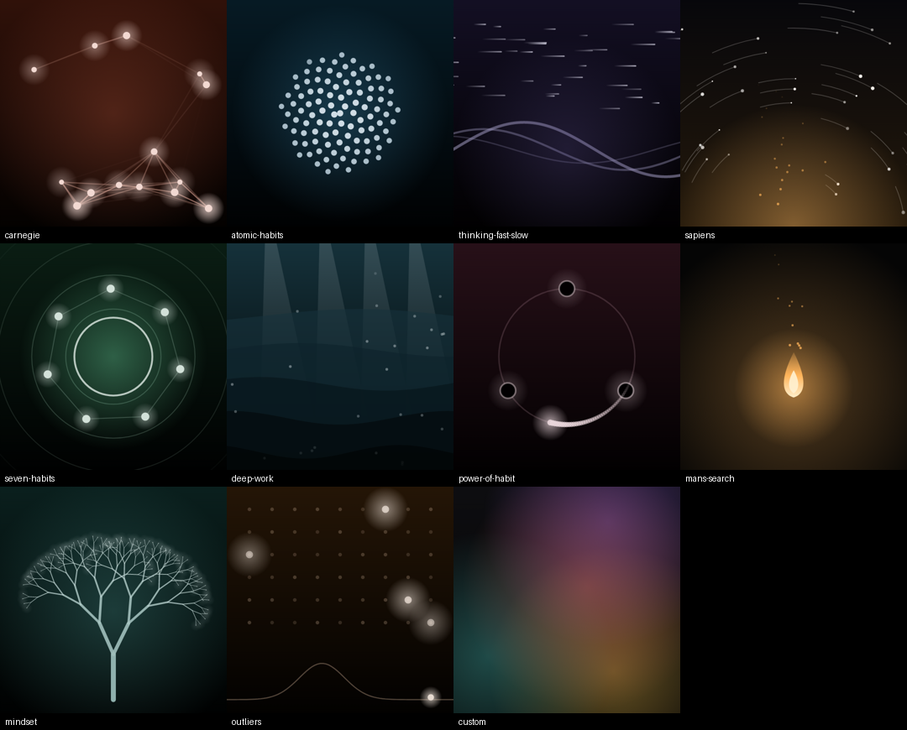
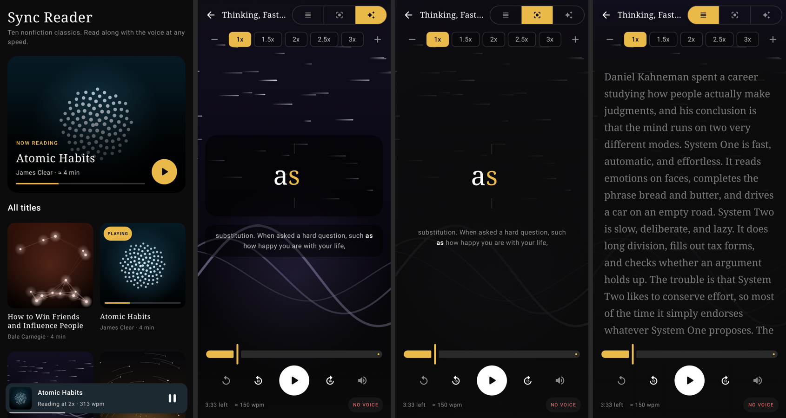

# Sync Reader (Android)

Speed-reading app that keeps the highlighted word locked to spoken audio at 1x, 1.5x, 2x, 2.5x, 3x
(and any quarter-step from 0.5x to 4x).

- **Library home screen** with ten popular nonfiction books, each with an original summary written for
  the app (How to Win Friends and Influence People, Atomic Habits, Thinking, Fast and Slow, Sapiens,
  The 7 Habits of Highly Effective People, Deep Work, The Power of Habit, Man's Search for Meaning,
  Mindset, Outliers). Nothing to import; progress is remembered per title.
- **Living artwork for every title**, Spotify Canvas style. Each book has its own looping scene drawn in code
  (people connecting for Carnegie, a compounding spiral for Atomic Habits, a single flame for Frankl, and so
  on). The art fills the library covers, the now-playing bar, and the reader. Its tempo follows narration
  speed. It never competes with the words: Visual mode puts the current word on dark glass over full-strength
  art, Focus darkens the center, and Flow keeps the art to a band behind the title. System "remove
  animations" freezes it on a still frame.
- **Now-playing bar**: narration keeps going when you go back to the library; play, pause, or jump back in.
- **Audio** comes from the phone's built-in text-to-speech engine. No accounts, no network.
- **Sync** uses the engine's word-range callbacks, so highlighting is word-exact on Google's TTS. Engines
  that do not report ranges fall back to a timer calibrated from the voice's measured speaking rate.
- **Visual view** (default) shows one word at a time over the title's full-screen artwork.
- **Flow view** shows the full text, highlights the current word and auto-scrolls. Tap any word to jump.
- **Focus view** shows one word at a time, centered on its optimal recognition point.
- **Share** text from any app, or select text and pick "Sync Reader" from the toolbar.
- **Silent mode** runs the same highlighting without audio.




## Build

Requires JDK 17+ and the Android SDK (platform 35).

```
cd sync-reader-android
./gradlew assembleDebug          # or: gradle assembleDebug
adb install app/build/outputs/apk/debug/app-debug.apk
```

Open the project folder in Android Studio to run on an emulator or device.

`./gradlew testDebugUnitTest` also renders every scene and the main screens to `app/build/screenshots`
with Robolectric, so the artwork can be reviewed without a device.

## Layout

- `app/src/main/java/com/aidantorrence/syncreader/Library.kt` – the ten built-in titles and their summaries
- `.../Visuals.kt` – the eleven generative scenes and the animation clock
- `.../LibraryScreen.kt` – home screen, cover grid, now-playing bar
- `.../Document.kt` – tokenizing, paragraph and utterance chunking
- `.../ReaderViewModel.kt` – TextToSpeech playback, sync, calibration, persistence
- `.../ReaderScreen.kt` – Compose UI (Flow view, Focus view, controls, text editor)
- `.../MainActivity.kt` – entry point and share/process-text intents
