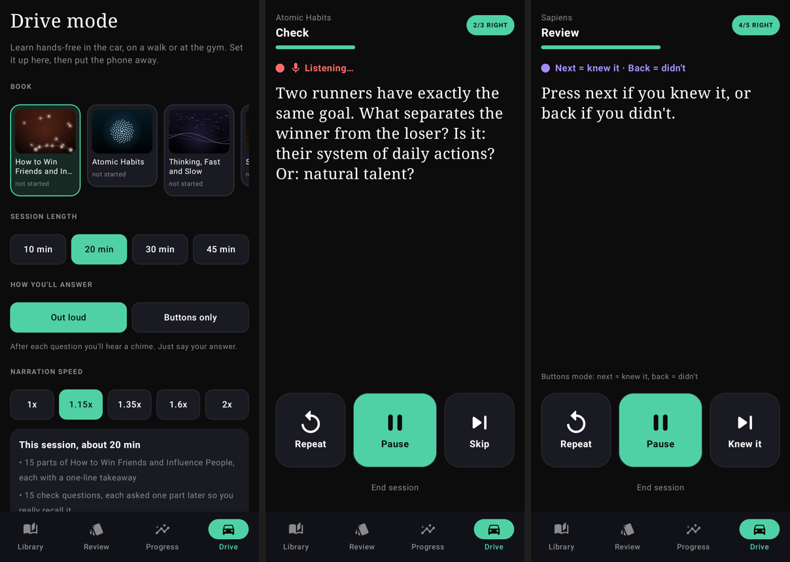
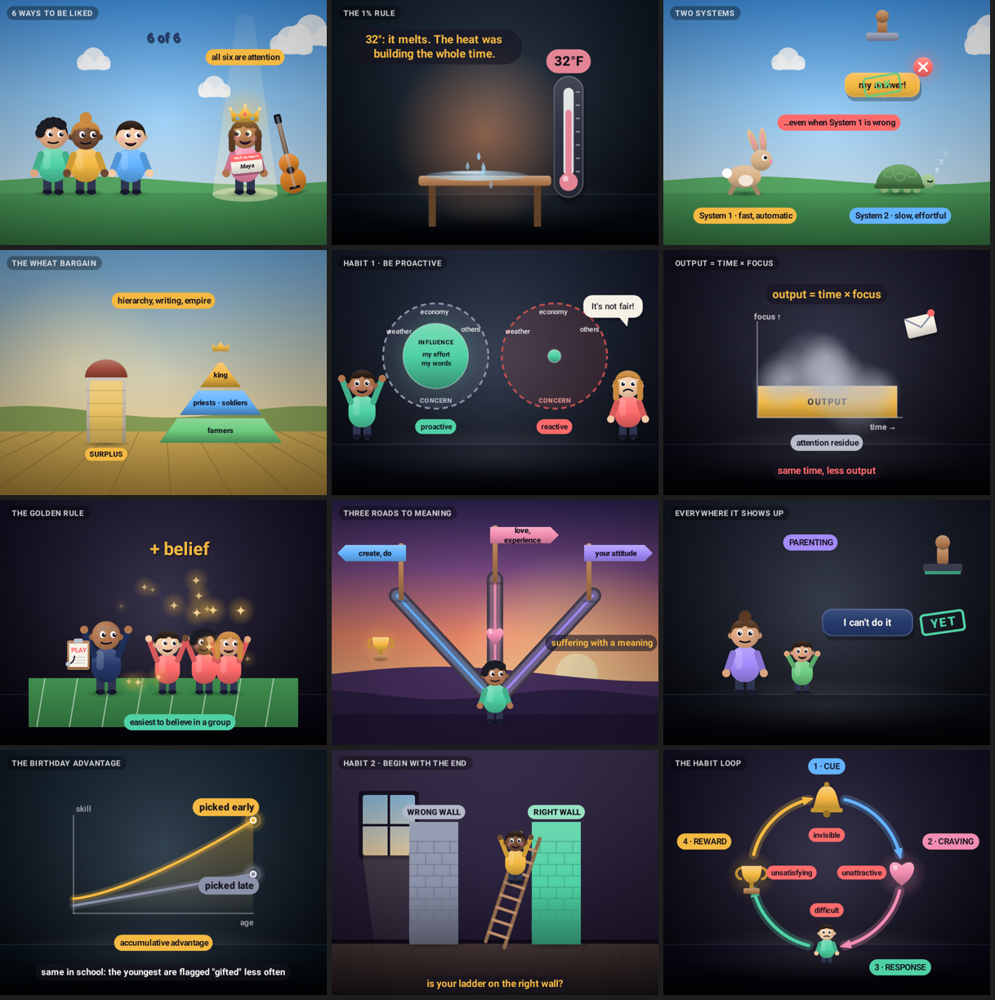
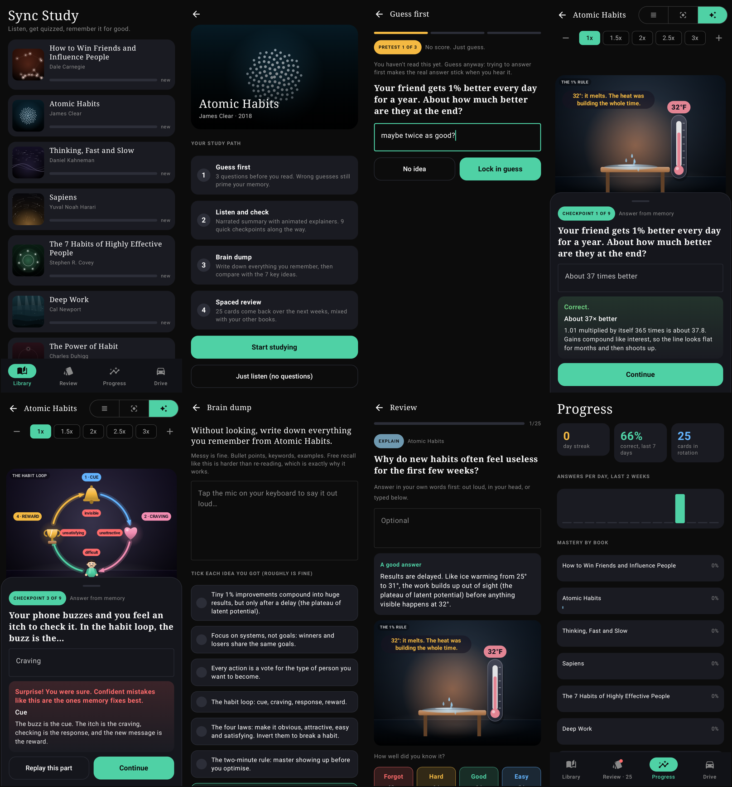

# Sync Study (Android)

A study-focused sibling of Sync Reader. Same narrated speed reading with the word kept in sync with the voice,
rebuilt around the learning techniques with the strongest evidence behind them, and animated explainer films
for every paragraph. Installs next to Sync Reader (`com.aidantorrence.syncstudy`) with its own progress.

## How a book is studied

1. **Guess first (pretest).** Three questions before you read. No score. Trying to answer primes memory for the
   real answer, even when the guess is wrong. You type a guess (or tap "No idea"); there are no options to pick from.
2. **Listen and check.** The narrated summary plays with an animated explainer above the speed-reading word.
   At the end of every paragraph the narration pauses for a checkpoint question, answered from memory, with a
   confidence rating before the reveal. No answer options are shown anywhere: you type the answer, it's scored by
   key words, and when it can't tell, you compare with the real answer and say whether you had it. Wrong answers can replay that paragraph. The paragraph's finished scene
   stays on screen while you answer.
3. **Brain dump.** Write (or dictate) everything you remember, then tick off the key ideas you got.
4. **Spaced review.** Every card is scheduled with an SM-2 style algorithm, mixed with other books, and missed
   cards come back in the same session until you get them.

| Technique | Where |
|---|---|
| Pretesting | Guess-first questions |
| Retrieval practice | Checkpoints, review cards, brain dump |
| Spaced repetition | Review queue (10 min, 1 day, 3 days, then growing) |
| Interleaving | Review sessions mix books |
| Elaborative interrogation / self-explanation | "Explain" cards with model answers |
| Confidence + hypercorrection | Confidence rating; confident errors are flagged |
| Successive relearning | Missed cards re-queued within a session |
| Dual coding | Animated scenes, and a scene still on every card |

## Drive mode (hands-free)

The Drive tab runs a study session you can do in the car, on a walk or at the gym, with the screen off.
Pick a book and a length (10–45 min) before you set off; everything after that is voice and buttons.

- **Session shape:** two warm-up reviews, two guess-first questions for a new book, then the book narrated part by
  part. Each part ends with a one-line spoken takeaway that turns its animated scene into a picture in words.
  Each part's check question is asked one part later (a short lag makes recall effortful), due reviews from
  other books are mixed in, a spoken brain dump closes a finished book, and spare time carries on into your
  next unfinished book.
- **No hints, only recall:** questions are asked open-ended, with no answer options read out (stems that only work
  with options are rewritten as open questions). Answers are scored by key words; when it can't tell, you hear the
  model answer and say yes or no. Fill-in-the-blanks are said out loud.
- **Answers by voice** after a chime (on-device recognition when available). Spoken numbers, near-misses and
  "the second one" are understood. Say "repeat", "skip", "I don't know", "slower", "faster", "pause", "done".
- **Never blocks:** silence reveals the answer after a few seconds and schedules the card sooner.
- **Buttons instead of voice:** steering-wheel / headset play-pause, next (skip, or "I knew it" after an answer)
  and previous (repeat, or "I didn't"). If recognition fails mid-session it switches to buttons automatically.
- **Car-friendly audio:** a foreground media service keeps playing with the screen off, shows lock-screen and
  notification controls, pauses for navigation prompts and calls, and uses a second voice for questions plus
  chimes for question / listening / right / wrong.
- Results go into the same spaced-repetition schedule as the rest of the app.

Code: `DriveModel.kt` (planning, spoken questions, speech scoring), `DriveEngine.kt` (session engine),
`DriveAndroid.kt` (voices, chimes, recognition, audio focus), `DriveService.kt` (foreground media service),
`DriveScreen.kt` (setup and live screens), `DriveLines.kt` (spoken takeaways).



## Animated explainers

`Stage.kt` is a small timeline engine: a scene has a backdrop, a cast of illustrated props and a list of beats.
Each beat is pinned to a phrase in the paragraph and tweens actor properties (position, scale, rotation, opacity,
and prop-specific values like a character's mood or an ice cube's melt), with camera pans and zooms. Everything is
a pure function of time since each beat started, so it stays in sync at any speed and renders the same in tests.

- `Art.kt`: palette, shading, shadows, text, backdrops
- `Props.kt`: shared illustrated props (characters, charts, calendar, phone, icons, particles…)
- `Props<Book>.kt`, `Stage<Book>.kt`: book-specific props and scenes
- `Study<Book>.kt`: questions, explain cards, fill-in-the-blanks, key ideas




Animated previews (one paragraph each, 1x narration timing): `docs/previews/*.mp4`.

## Build and test

```
cd sync-study-android
./gradlew assembleDebug
./gradlew testDebugUnitTest
```

The unit tests check that every animation step's phrase exists, in order, in its paragraph, that every
paragraph has a checkpoint, and test the scheduler. They also render every scene to `app/build/stage`
(stills and one frame per step) and the main screens to `app/build/screens`, using Robolectric, no device
needed. `-Pstage.books=atomic-habits -Pstage.frames=true` renders 12 fps frame sequences for previews.
